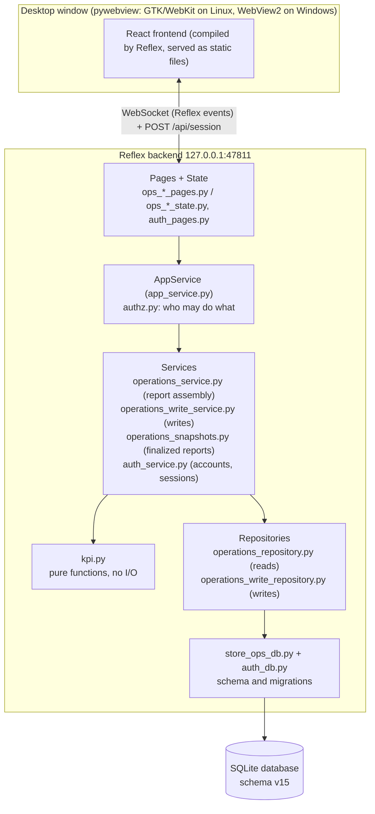
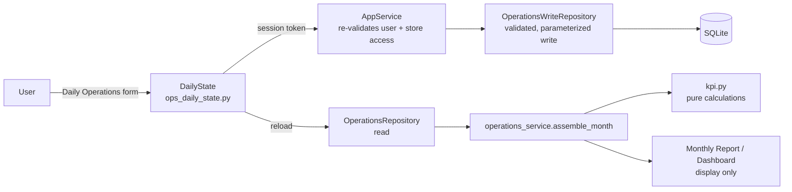
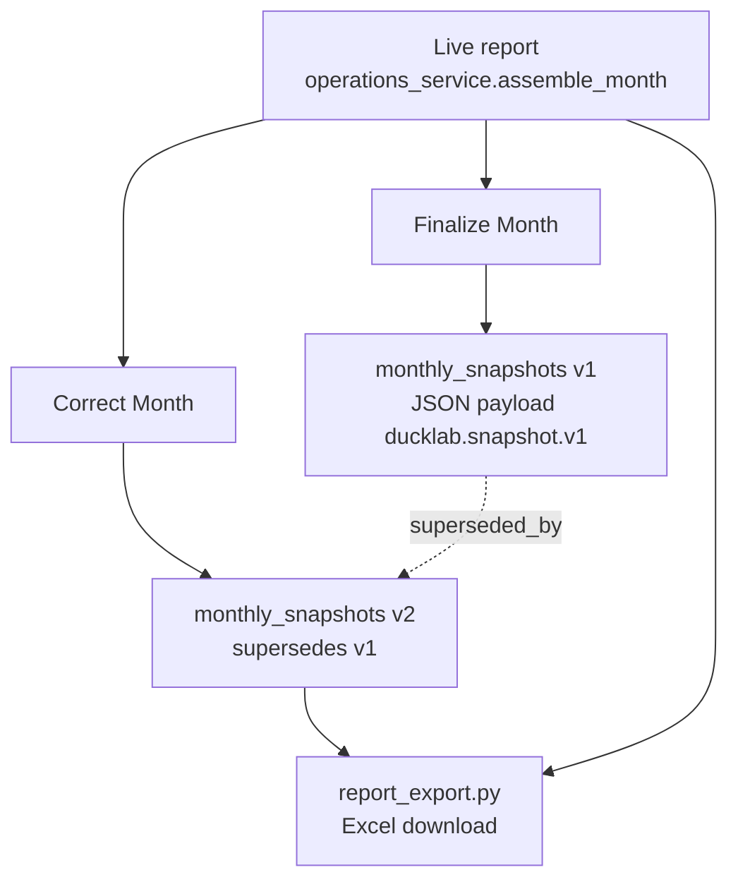
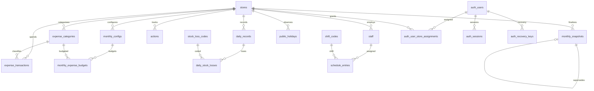
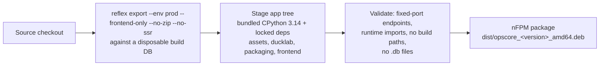
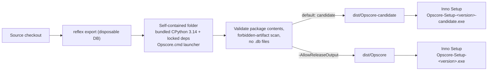

# Opscore Architecture

This document describes how Opscore is built: its layers, data model,
security model, KPI engine and desktop packaging.

For product scope see the [Project Overview](PROJECT_OVERVIEW.md). For schema
history and upgrade procedures see [Migrations](MIGRATIONS.md). For build and
release history see the [Changelog](CHANGELOG.md).

---

## 1. Overview

Opscore is a full-stack Python app built with **Reflex 0.10.1**. Reflex
compiles the UI to a React frontend and runs a Python backend. The two talk
over a WebSocket. Data is stored in a single **SQLite** file per user.

The packaged app is a local desktop application: a launcher starts a
loopback-only backend on `127.0.0.1:47811` and opens a native window (GTK /
WebKit2 on Linux, WebView2 on Windows), with browser fallbacks.



## 2. Technology

| Part | Choice |
|---|---|
| Language | Python 3.14 |
| Framework | Reflex 0.10.1 (React frontend, Python backend) |
| Backend server | Granian ASGI server |
| HTTP integration | Starlette endpoints via Reflex `api_transformer` |
| UI kit | Radix Themes (light default, dark selectable), Tailwind v4 |
| Charts | Plotly 6.3.1 |
| Guided tours | driver.js 1.3.1 (bundled locally) |
| Database | SQLite (Python `sqlite3`) |
| Passwords | Argon2id (argon2-cffi 25.1.0) |
| Excel | openpyxl 3.1.5 (export); stdlib zipfile + XML (DSC import) |
| Desktop window | pywebview 6.2.1 |
| Packaging | nFPM (.deb), Inno Setup (Windows installer), PyInstaller (frozen build) |

Direct dependencies are listed in `requirements.txt`. All transitive versions
are pinned in `requirements.lock`, which is what builds use.
`requirements-dev.txt` adds test-only tooling (pytest, Playwright and the
httpx2 backend used by Starlette's TestClient) and is never installed in
production.

## 3. Layers and rules

Each layer only calls the one below it.

| Layer | Files | Responsibility |
|---|---|---|
| Pages | `ops_*_pages.py`, `auth_pages.py`, `ops_shell.py`, `ui.py`, `design.py` | Layout and components. Display only. |
| State | `ops_shared_state.py`, `ops_state.py`, `ops_*_state.py` | Page state and event handlers. Formats values for display. Calls `AppService`. |
| App service | `app_service.py` | The single entry point for every operation. Resolves the signed-in user and checks access before anything runs. |
| Access control | `authz.py` | Deny-by-default role and store checks. |
| Services | `operations_service.py`, `operations_write_service.py`, `operations_snapshots.py`, `auth_service.py`, `backup.py`, `report_export.py`, `dsc_import.py` | Business workflows. |
| KPI engine | `kpi.py` | Every business calculation, as pure functions. |
| Repositories | `operations_repository.py`, `operations_write_repository.py` | Parameterized SQL, store-scoped, explicit transactions. |
| Database | `store_ops_db.py`, `auth_db.py` | Schema, migrations, connections. |

**Presentation and accessibility:**

- `ui.py` is the shared component kit. Reuse `metric_label`,
  `labelled_select`, `success_callout`, `empty_state` and `chart_card` rather
  than implementing these behaviors independently on each page.
- `assets/accessibility.css`, registered by `ducklab.py`, supplies global
  `:focus-visible` outlines, 44px coarse-pointer targets and reduced-motion
  handling. Desktop controls remain compact.
- Radix select labels belong on the focusable trigger. Metric definitions use
  a tooltip for mouse/keyboard input and a popover for touch. Plotly chart
  roles/names live on a stable Reflex wrapper because Plotly replaces its own
  rendered container; concise summaries and existing detail tables provide the
  nonvisual data alternative.
- Permission-dependent component branches must use `rx.cond`, not Python
  truth-value tests on Reflex state vars. Success feedback uses a polite live
  region without moving focus, and status meanings are not conveyed by colour
  alone.

**Hard rules:**

1. **All KPI logic lives in `kpi.py`** (assembled by `operations_service.py`).
   Pages and state never calculate business figures.
2. **Every operation goes through `AppService`.** User IDs, roles or store IDs
   sent from the browser are never trusted; the caller is resolved from the
   session token and re-validated on every event.
3. **Money is integer cents** everywhere below the display layer. No
   floating-point currency maths.
4. **NULL means "not reported"** and is never turned into 0. An entered 0 is
   a real zero.
5. **Percentages are stored as fractions** (10% is 0.10).
6. **Page states are flat.** Every `/ops` page state inherits
   `SharedOpsState` directly; siblings share one instance for selectors and
   the status surface and wire cross-page refreshes by yielding each other's
   events. `SharedOpsState` owns the rolling 60-month selector (current month
   plus the previous 59), validates and clamps Month/Year combinations, and
   keeps the canonical `selected_month_label`; page handlers preserve that
   label when Reflex supplies a raw month or year event payload before their
   normal reloads.

### Data flow: daily entry to report



### Finalization and correction



Snapshots keep KPI **outputs**, not a full history of the input records.
Latest-version lookups and the Finalized version list include only rows with
`finalized = 1`, so draft snapshots never appear as finalized reports.
**All Stores** remains live-only and cannot be finalized.

## 4. Data model

One SQLite file holds both operations data and accounts. Schema version is
tracked in `schema_migrations` and `PRAGMA user_version` (currently **15**).
Initialization is idempotent and migrations are additive. Each migration runs
in its own transaction, and its `PRAGMA user_version` update commits in that
same transaction; a failure rolls back the whole step so it can be retried.
See [Migrations](MIGRATIONS.md) for the full history.

### Core relationships



Composite foreign keys such as
`monthly_expense_budgets (store_id, monthly_config_id) → monthly_configs
(store_id, id)` and `schedule_entries (store_id, staff_id) → staff
(store_id, id)` enforce store-scoping at the database level, not just in
application checks.

### Operations tables

| Table | Holds |
|---|---|
| `stores` | Code (unique), name, Concept, State, zone, zone PIC, branch manager, active flag |
| `monthly_configs` | One row per store and month: targets, uplifts, comparisons, BD Target, salary ratio target, headcount, stock loss target, BV/UPT targets, payroll figures |
| `store_directory` | Imported store directory: code (unique), name, State, zone, display area, BD Target (October 2026). Reference data only; no stores are created from it |
| `store_directory_history` | Imported monthly sales per store code and month (integer cents). Feeds the Sales History chart and the Monthly Setup history button |
| `store_directory_info` | Singleton: last directory import timestamp, source filename and `bundled` provenance flag (v17) |
| `public_holidays` | Holiday dates per store |
| `daily_records` | One row per store and date: sales, transactions, units, informational Void/Refund totals, staffing and leave counts. Void/Refund never affect Sales or KPI calculations |
| `daily_stock_losses` | Stock loss amount per daily record and loss code |
| `stock_loss_codes` | The 13 codes and whether each adds to, reduces or doesn't affect Total Loss |
| `expense_categories` | Store's expense categories |
| `monthly_expense_budgets` | Budget per category per month |
| `expense_transactions` | Expense register lines: dates, category, amount, paid by, status, receipt, verification |
| `actions` | Action Tracker items: pillar, issue, owner, priority, status, due date |
| `monthly_snapshots` | Finalized monthly reports, versioned |
| `contribution_shares` | Daily Sales Contribution by State, Concept and day type |
| `basket_benchmarks` | State average BV and UPT by Concept and month |
| `reference_data_info` | When and from which file the reference data was loaded |
| `staff` | Store-scoped staff roster: name, staff ID, position and employment type |
| `shift_codes` | Shared shift codes, labels, working times and colors |
| `schedule_entries` | Staff shift assignments by store and date |
| `schedule_targets` | Target manpower per store and week |

### Account tables

| Table | Holds |
|---|---|
| `auth_users` | Email, display name, Argon2id hash, active flag, tour status |
| `auth_roles`, `auth_user_roles` | Roles and who has them |
| `auth_user_store_assignments` | Which stores each user may access |
| `auth_sessions` | Server-side sessions (12-hour lifetime) |
| `auth_audit_events` | Sign-in, password and admin events |
| `auth_page_tours` | Which page tours each user has completed |
| `auth_recovery_keys` | SHA-256 hashes of single-use recovery keys |
| `auth_login_failures` | Persistent rate-limiting failure timestamps, created by v15 |

## 5. KPI engine (`kpi.py`)

Pure functions with no database or UI access. The main groups:

| Area | Rules |
|---|---|
| Sales | Days entered, sales to date, projected month-end sales (actual if every day is entered, otherwise sales ÷ days entered × days in month); daily Contribution is the imported share normalized by the month's total shares |
| Target levels | Level 1 = base. Levels 2 to 4 = Level 1 × (1 + uplift). Level 4 is never below the minimum RTM target. Highest level reached. |
| Basket | BV = sales ÷ transactions. UPT = units per transaction. ASP = sales ÷ units. Blank when the divisor is 0 or missing. |
| Daily targets | Each day's target = Level 1 × that day's contribution share (weekday or public holiday, by State and Concept). A shortfall carries forward to the next *reported* day only. |
| Expenses | Paid, incurred and pending totals, budget status, lines needing review |
| Manpower | Salary ratio and status, salary budget, FT-only headcount variance and turnover, effective staff-days, PT active/average/peak attendance and PT contribution |
| Stock | Total Loss from signed loss codes, loss ratio against target |
| Actions | Month scope, open, overdue and completed counts |

Operational dates use **Asia/Kuala_Lumpur**. Money stays in integer cents;
conversion to display values happens only at the presentation boundary.

Parsing helpers in `input_validation.py` (`parse_money_cents`, `parse_count`,
`parse_decimal`) are shared by every data-entry page so validation is
identical everywhere. Money accepts commas and an `RM` prefix, rejects
sub-cent and non-finite values, and caps amounts at RM 100,000,000; counts are
non-negative whole numbers capped at 1,000,000.

### Weekly schedules

Schedule reads and writes go through `AppService`, with store access enforced
by `authz.py`. Staff rosters and entries are store-scoped; shift codes are
shared and can only be changed by users with the global configuration
permission (Super Admin or Administrator). Each staff member has an
employment type (`Full-Time`, `Part-Time` or `Not Set`). Only shift codes
with working times count toward daily headcount, and schedule staffing uses
employment type to separate full-time and part-time workers.

`ops_schedule_state.py` writes individual and combined MyESS CSV files to
`Documents/Opscore Schedules/<store-code>/<week-start>/` and reports malformed
schedule weeks as validation errors. New Daily Entries auto-fill FT/PT, AL,
RPL (Other Paid Leave) and UPL once; saved actuals are preserved. MC and EL
are manual exceptions and never schedule-derived. Paid-leave reporting adds
MC to Other Paid Leave without double-counting Total Leave.

Each shift code's `show_in_legend` setting filters the generated View legend
without changing Planner, headcounts or exports. Generated names clamp to two
lines. `schedule_pdf.py` writes fitted A4-landscape PDFs directly to the
store/week schedule folder; no browser print dialog or popup is involved.

Store/month public holidays appear as PH markers. `assignment_source` tracks
automatic ABM-only OPH entries: on a holiday, every ABM assignment becomes OPH,
including an existing manual shift; other staff and non-holiday assignments are
unchanged. Removing a holiday clears only its automatic OPH assignments.

## 6. Security model

### Authentication

- Passwords hashed with Argon2id. Minimum 10 characters with letters and
  digits. A dummy-hash verification equalizes timing for unknown emails.
- Sessions are server-side with a 12-hour lifetime. The browser holds only an
  HttpOnly, SameSite=Lax cookie set by `POST /api/session`. No session token
  ever enters Reflex state, client storage or logs.
- Signing in rotates the session. Signing out revokes it on the server.
- Sign-in attempts are rate-limited per email and per client, stored in
  SQLite so limits survive restarts and are shared across workers.
- The session endpoint and the WebSocket both check that Origin matches Host.
- The session endpoint caps request bodies at 4 KiB.
- `/api/health` is unauthenticated and returns only `{status, release}`.

### Password recovery (recovery keys)

Each account can hold one **single-use recovery key**, issued at first-admin
bootstrap and replaceable in **Settings → Account → Recovery Key** (requires
the current password). Only the key's SHA-256 hash is stored; the raw key is
shown once and saved by the owner as a recovery-kit text file. On `/login`,
**Forgot password?** accepts the key and a new password: the key is consumed
atomically, the password hash replaced, all sessions revoked, and a
replacement key returned once. Failures return a generic message and are
rate-limited per client. If both password and key are lost, the offline
`scripts/recover_admin_password.py` remains the last resort.

### Authorization (`authz.py`)

Deny by default. Store access comes only from explicit assignments, never
from matching zone names.

| Role | Can do |
|---|---|
| Super Admin | Everything, all stores. Users, roles, store access, backup and restore. |
| Administrator | Assigned stores: all records, Monthly Setup and budgets, finalize and correct reports |
| Zone Manager | Assigned stores: daily, stock, expenses, actions. Read reports. |
| Branch Manager | Assigned stores: daily, stock, expenses, actions. Read reports. |
| Viewer | Assigned stores: read only |

Payroll figures never enter page state unless the user can manage
configuration (Super Admin or Administrator). A deactivated store becomes
read-only but keeps all its history.

### Local security boundary

The packaged app binds to loopback only. Any local process can attempt to
reach the loopback API; protection relies on cookie secrecy and Origin
checks, not on client certificates. A local process that occupies port 47811
before launch simply blocks startup (fail-closed). The Windows shutdown named
pipe and the Linux focus endpoint are unauthenticated on loopback.

### Environment settings

| Variable | Default | Purpose |
|---|---|---|
| `OPSCORE_DESKTOP` | unset | When `1`, pins the backend to port 47811 and loopback API URL (`rxconfig.py`) |
| `DUCKLAB_DB_PATH` | `ducklab/store_ops.db` | Database file. The desktop launcher sets it to the per-user data directory. |
| `DUCKLAB_RELEASE_ID` | `dev` | Version shown in Settings → About and `/api/health`; set from the packaged `RELEASE` file |
| `DUCKLAB_SECURE_COOKIES` | off | Marks the session cookie Secure (HTTPS only). Desktop forces it off for plain loopback HTTP. |
| `DUCKLAB_TRUST_PROXY` | off | Trust `X-Forwarded-For` from a private/loopback reverse proxy for rate limiting and logs |
| `DUCKLAB_FRONTEND_ORIGINS` | empty | Extra Origins allowed to call `/api/session`. Development only. |
| `REFLEX_ENV_MODE` | — | `prod` in packaged runs |
| `REFLEX_MOUNT_FRONTEND_COMPILED_APP` | — | `true` in packaged runs; serves the prebuilt frontend |
| `REFLEX_SKIP_COMPILE` | — | Prevents workers recompiling the frontend in packaged runs |
| `REFLEX_WEB_WORKDIR` | — | Relocates `.web` runtime writes to per-user data (frozen Windows backend) |
| `REFLEX_STATES_WORKDIR` | — | Per-user Reflex state directory (desktop) |
| `REFLEX_UPLOADED_FILES_DIR` | — | Per-user upload directory (desktop) |
| `REFLEX_TELEMETRY_DISABLED` | — | `1` in desktop runs |
| `REFLEX_CHECK_LATEST_VERSION` | — | `false` in packaged runs |
| `OPSCORE_VERSION` | — | Build-time package version (build scripts and `nfpm.yaml`) |
| `PYWEBVIEW_GUI` | — | `gtk` on Linux to select the GTK backend |

### Privacy

- Each user's data stays in their own database on their own computer.
- Company concept names are replaced with aliases in code and data.
- Real workbook data used for tests lives in the git-ignored `tests/private/`.
- The desktop builds fail if any `.db` file would be included in the package.

## 7. Reference data import

`dsc_import.py` reads the Daily Sales Contribution workbook by column
position:

- **DSC sheet:** State, Concept, day type (Mon to Sun or PH), and each
  month's share from November to October.
- **SPR sheet:** average BV and UPT by Concept and State for each month (the
  workbook labels these SPR and IPR).

Blank State or Concept cells under a merged group take the value above. Both
tables are replaced in one transaction: the whole file imports or nothing
changes. Import supports database schemas v5 through v9 as well as v10 by
feature-detecting the `bundled` column. The same function powers **Settings →
Reference Data** and `scripts/import_dsc.py`. The upload handler checks the
global configuration permission before reading the file and rejects uploads
larger than 64 MiB.

The Git-tracked default workbook `ducklab/data/DSCSPR_alias_2027.xlsx` is
loaded by `reference_bootstrap.py` when both reference tables are empty. It is
also refreshed when the stored copy came from the bundle but no longer matches
the bundled workbook; user-uploaded reference data is never replaced. The
workbook is bundled into `.deb` and Windows builds. Default expense categories
are seeded per store only when a store has no categories.

#### Store directory (monthly sales workbook)

`store_directory_import.py` reads a monthly-sales workbook (one row per store,
one dated column per month) and replaces `store_directory` and
`store_directory_history` in one transaction. It reuses the stdlib `.xlsx`
reader from `dsc_import.py`; month headers arrive as Excel serial numbers and
are converted to `YYYY-MM`. Only Code, Name, Display Area, State, Zone and the
monthly sales are read — **Concept is never imported**, because Concept is an
Opscore dropdown tied to the DSC reference data. Blank and zero months are
skipped, so the directory never records a zero-sales month, and amounts are
stored as integer cents rounded half-up. No stores, monthly configs or daily
records are written by the import. The same function powers **Settings →
Reference Data** and `scripts/import_store_directory.py`.

The workbook's **BD Target** column is imported as reference data into
`store_directory.bd_target_cents` (v18). The file does not say which month it
covers, so the month is declared in code as `BD_TARGET_MONTH = "2026-10"`
(October 2026) on the business's instruction. A blank cell, the workbook's
"NIL" text and a numeric 0 all mean "no target" and import as None, never as
RM 0. The figure feeds no KPI, target level, budget or achievement number:
`monthly_configs.bd_target_cents` (v16) remains the per-store, per-month value
the user types in Monthly Setup.

The Git-tracked workbook `ducklab/data/store_directory_2025_2026.xlsx` is
loaded by `reference_bootstrap.load_bundled_store_directory` at startup when
the directory is empty, and refreshed when the stored copy came from the
bundle but no longer matches the bundled workbook (an upgrade). A directory
the user uploaded is never replaced: `store_directory_info.bundled` (v17)
records the provenance. The workbook is bundled into `.deb` and Windows
builds alongside the DSC workbook. Seeding failures are logged and non-fatal.

Consumers:

- **New Store** (`StoresState.autofill_from_directory`, on field blur) matches
  an exact full code or full name (case-insensitive) and fills Name, State and
  Zone. Editing an existing store never auto-fills, and Concept is left to the
  user.
- **Monthly Setup** (`SetupState.load_history_from_directory`, explicit history
  icon with a tooltip and `aria-label="Load History From Directory"`, element id
  `setup-load-history`) fills Sales Last Month / Last Year from the directory for
  the selected store and month, plus the imported BD Target. Nothing is saved
  until Save Setup; missing months fill blank.
- **Sales History** (`ops_charts.history_timeline` /
  `history_year_compare`) draws the imported months on the Sales page with a
  Timeline / Year vs Year toggle, following the same gap rule as the daily
  charts. It is independent of the daily records.

## 8. Backup and restore (`backup.py`)

- **Backup** uses SQLite's online backup API, so it's safe while the app is
  running.
- **Restore** checks a temporary copy of the uploaded file: it must be a real
  SQLite database, pass integrity and foreign-key checks, contain the
  required tables and columns, not be from a newer schema, and have exactly
  the migration audit rows `1…user_version`. Uploads are self-contained `.db`
  files; arbitrary uploaded `-wal`/`-shm` siblings are ignored. Older schemas
  are migrated on the temporary copy. Once live WAL connections are quiesced,
  stale WAL/SHM sidecars are removed before the atomic replacement, so cleanup
  failure leaves the live database unrestored.
- Before pending migrations and every restore, the current database is copied
  into `backups/` next to it. The newest 10 automatic copies are listed in
  Settings and retained; manual and recovery artifacts are never pruned.
- Migration backup failure prevents migration. Newer schemas are rejected by
  ordinary startup as well as restore validation.
- Restore uploads are capped at 512 MiB.

Super Admin only. Because authentication tables live in the same database,
a restore also replaces identities, and the current session is signed out.
See [Migrations](MIGRATIONS.md) for procedures.

## 9. Desktop application lifecycle

### Entry points

| Entry point | Role |
|---|---|
| `ducklab/ducklab.py` | Reflex app object, routes, ASGI transformer, lifespan tasks |
| `packaging/opscore_desktop.py` | Single-instance native-window launcher |
| `packaging/opscore_backend.py` | Starts the prebuilt app on `127.0.0.1:47811` |
| `packaging/opscore_tray.py` | Optional Windows status-only notification-area icon (circular color/gray states) |
| `packaging/opscore-launcher`, `packaging/opscore-backend` | Linux shell wrappers using the bundled Python at `/opt/opscore` |
| `Opscore.cmd` (generated) | Windows folder launcher |

### Startup sequence

```mermaid
sequenceDiagram
    participant U as User
    participant L as Launcher (opscore_desktop.py)
    participant B as Backend (opscore_backend.py)
    participant W as Window

    U->>L: Open Opscore
    L->>L: Create data dir, acquire single-instance lock<br/>(flock / named mutex)
    alt already running
        L->>L: Focus existing window, exit
    end
    L->>L: Probe 127.0.0.1:47811 /api/health<br/>fail if port is owned by another app
    L->>L: Startup log rotation, then launch shared rotating sink
    L->>L: Keep/fresh database choice (first launch of a version)
    L->>L: Reject newer or audit-inconsistent database
    L->>B: Spawn backend with piped output<br/>env: DUCKLAB_DB_PATH, RELEASE_ID, prod flags
    B->>B: Backup if migration pending; versioned init, lifespan seeding
    L->>B: Wait up to 90 s for /api/health
    L->>W: Open GTK/WebKit (Linux) or WebView2 (Windows)<br/>fallback: Edge app mode / Chromium / default browser
    U->>W: Use the app
    U->>W: Close window
    W->>L: Window closed
    L->>B: Graceful stop (Windows named pipe) or SIGTERM process group<br/>forced kill after 20 s if needed
    L->>L: Release lock
```

The single-instance lock is a POSIX `flock` on `launcher.lock` on Linux and a
named mutex `Local\Opscore` on Windows. The fixed port means another
application squatting on 47811 blocks startup rather than silently moving to
another port.

### Windows status tray

On Windows, the launcher optionally starts `packaging/opscore_tray.py` while
the application window is open. The notification-area icon polls
`127.0.0.1:47811/api/health`: a full-color circular icon means the backend is
healthy, and a dimmed gray circular icon means it is not responding. The
**Open Opscore** action raises the existing window; **Quit** follows the
existing window-close shutdown path. Closing the window still stops the
backend and removes the icon—the tray is an indicator, not close-to-tray
behavior. If pystray/Pillow or the notification area is unavailable, startup
continues without a tray icon.

### User data and logs

| Path | Linux | Windows |
|---|---|---|
| Data directory | `~/.local/share/opscore` | `%LOCALAPPDATA%\Opscore` |
| Database | `store_ops.db` in the data directory | same |
| Log | `opscore.log`; live/startup rotation above 5 MiB, keep 3 archives | same |
| Automatic backups | `backups/`; pre-migration/pre-restore, newest 10 | same |
| Fresh-start copies | `store_ops.db.backup-N`; newest 10 after successful creation | same |
| Old native profiles | `webview.old-<timestamp>`; newest 3 | same |
| Reflex state / uploads | `states/`, `uploaded_files/` | same |
| Version/profile markers | `app_version.txt`, `webview`, `db-choice.json` | same |
| Schedule PDF/CSV exports | `~/Documents/Opscore Schedules/` | `%USERPROFILE%\Documents\Opscore Schedules\` |

Backend stdout/stderr and launcher diagnostics go through a launcher-owned,
line-buffered rotating sink. A reader thread continuously drains the backend
pipe so sustained output cannot block it; spawned workers inherit that pipe.
Rotation and write failures are reported without crashing Opscore. Fatal
startup errors also surface via a GTK dialog or the discovered zenity binary.

## 10. Build and packaging architecture

### Versioning

There is no in-repository version constant. Versions are injected at build
time: the `RELEASE` file, `DUCKLAB_RELEASE_ID`, and `OPSCORE_VERSION`. The
Windows installer reads its version from the packaged `RELEASE` file, so it
cannot drift from the folder it packages. Git tags are the historical version
anchors.

### Linux (.deb) pipeline



`scripts/build_deb.sh [VERSION]` builds the package. The `.deb` installs to
`/opt/opscore` and declares GTK3/WebKit2 dependencies. `postinst` only
refreshes desktop/icon caches; `prerm` preserves user data.

### Windows folder and installer pipeline



`scripts/build_windows.ps1` builds the folder. Candidate output is the
default; `-AllowReleaseOutput` is required for the release folder. When the
locked dependency set changes, the bundled runtime's pip is upgraded first
and then `requirements.lock` plus `requirements-windows.txt` are installed.
The Inno Setup script (`packaging/windows/opscore.iss`) compiles a per-user
installer that preserves user data and offers the keep/fresh database choice
when an existing database is detected. Existing installer output is protected
by default. After an explicit `-AllowReleaseOutput` folder build, deliberate
release-installer replacement uses
`ISCC.exe /DOPSCORE_ALLOW_OVERWRITE=1 packaging\windows\opscore.iss`; candidate
builds also pass their version and package-name defines. The build scripts do not sign the
installer. The published v1.2 installer was signed afterwards with a
self-signed `Opscore Development` Authenticode certificate and a DigiCert
timestamp. The signature protects file integrity but does not establish
publisher trust on an ordinary Windows machine; no private CA needs to be
installed to run the app. Signing keys and passwords are not stored in the
repository.

### Alternative frozen build

`packaging/windows/opscore.spec` is a PyInstaller one-folder specification
used by the manual `.github/workflows/windows-build.yml` workflow, which also
runs a frozen-backend smoke test. The release pipeline uses the
folder-plus-Inno path above.

### CI workflows

| Workflow | Trigger | What it does |
|---|---|---|
| `.github/workflows/release-windows.yml` | Release published / manual | Builds the Windows folder and installer and uploads the installer to the release |
| `.github/workflows/windows-build.yml` | Manual | Frozen PyInstaller build + smoke test |
| `.github/workflows/windows-check.yml` | Manual | Installs locked deps and runs the test suite on Windows |

There is no Linux CI workflow; the `.deb` build and test suite are run
locally.

## 11. Testing and verification

Tests use disposable temporary databases only; no test opens the live/dev
database. The migration suite includes fault injection at every version
boundary, asserting the database is byte-identical after a failed migration
and that a retry succeeds.

Verified commands (from project instructions):

```bash
# Full test suite
.venv/bin/python -m pytest tests/ -q

# Production frontend compile against a disposable database
DUCKLAB_DB_PATH=$(mktemp -d)/compile.db .venv/bin/reflex export --env prod --frontend-only --no-zip
```

## 12. Development

### Setup

```bash
pip install uv
uv venv --python 3.14 .venv
uv pip install --python .venv/bin/python -r requirements.lock -r requirements-dev.txt
```

### Run from source (Linux)

```bash
DUCKLAB_DB_PATH=$(mktemp -d)/dev.db .venv/bin/reflex run
```

The frontend is served on `http://localhost:3000` and the backend on
`http://localhost:8000` in development mode.

### Run from source (Windows)

Run the source checkout directly; this does not create a package or installer.

```powershell
py -3.14 -m venv .venv
.\.venv\Scripts\python.exe -m pip install -r requirements.lock
# Optional: native WebView2 window and status-only tray icon
.\.venv\Scripts\python.exe -m pip install -r requirements-windows.txt
```

Build the frontend once (and again whenever frontend source changes):

```powershell
$env:OPSCORE_DESKTOP = "1"
$env:DUCKLAB_DB_PATH = "$env:TEMP\opscore-frontend-build.db"
$env:REFLEX_ENV_MODE = "prod"
$env:REFLEX_CHECK_LATEST_VERSION = "false"
.\.venv\Scripts\python.exe -m reflex export --env prod --frontend-only --no-zip
Remove-Item Env:OPSCORE_DESKTOP, Env:DUCKLAB_DB_PATH, Env:REFLEX_ENV_MODE, Env:REFLEX_CHECK_LATEST_VERSION
```

Then run the launcher:

```powershell
.\.venv\Scripts\python.exe packaging\opscore_desktop.py
```

The window opens in this order: WebView2 → Edge app mode → default browser.
In default-browser mode, keep the PowerShell window open and press **Ctrl+C**
there to stop Opscore.

### Development and QA scripts

| Script | Purpose |
|---|---|
| `scripts/build_deb.sh` | Build the Ubuntu/Debian desktop package |
| `scripts/build_windows.ps1` | Build the self-contained Windows folder |
| `scripts/import_demo.py` | Import the AB01 demo CSVs into a given database |
| `scripts/import_dsc.py` | Import the Daily Sales Contribution workbook (requires `DUCKLAB_DB_PATH`) |
| `scripts/import_store_directory.py` | Import the monthly-sales workbook into the store directory (requires `DUCKLAB_DB_PATH`; creates no stores) |
| `scripts/import_workbook_dev.py` | Import a workbook into a dev database, with a `--verify` parity check |
| `scripts/bootstrap_admin.py` | Create the first admin from the terminal |
| `scripts/recover_admin_password.py` | Offline admin password recovery (backs up the DB, revokes sessions) |
| `scripts/seed_ui_*.py` | Seed disposable dev databases for screenshots and browser tests |
| `scripts/browser_test_*.py` | Playwright browser checks |
| `scripts/cloud_screenshots.py` | Seeded disposable-database screenshots across desktop/mobile and light/dark modes |

`tests/test_ui_accessibility.py` covers the shared interaction rules without a
database. Run it with `.venv/bin/python -m pytest tests/test_ui_accessibility.py -q`;
run the complete suite and production frontend export before opening a PR.
Browser QA must use a disposable database, complete or dismiss first-run tours,
and check keyboard focus, touch disclosures, chart names/summaries, horizontal
overflow and tooltip/popover viewport bounds.

## 13. Operational database and desktop safeguards

- Schema **v15** is the versioned authentication baseline. All auth tables,
  indexes, roles, additive columns and persistent login throttling are created
  transactionally by the shared migration runner. `auth_db.init_auth()` remains
  only as a compatibility entry point.
- `PRAGMA user_version` drives migration decisions, but its audit trail must
  contain exactly `1…N`. Missing or extra migration rows, and a missing audit
  table for nonzero versions, are rejected before backup or modification.
  Restore applies the same validation.
- Controlled initialization enables **WAL** after compatibility checks and
  migrations. Application and backup connections enable foreign keys and a
  **10-second busy timeout**. Online backups include committed WAL content.
  Restore normalizes uploads through SQLite's backup API, validates the staged
  copy, checkpoints/quiesces the live database, removes stale sidecars and
  atomically replaces the main file. Sidecar cleanup precedes replacement, so
  a cleanup error cannot be misreported as leaving an installed restore
  untouched. Existing live connections must finish and close before
  WAL-enabled replacement can proceed.
- `AppService.transaction()` shares one connection across its fixed read,
  write, authentication and snapshot participants. Repository commit/close
  calls defer to the outer owner; rollback and SQL errors mark the scope
  failed so a caught inner error cannot lead to an outer commit. Nested or
  overlapping transactions on one `AppService` are rejected rather than
  mutating the active shared-connection state.
- Launcher and backend output share a continuously drained, launcher-owned
  logging sink. The active log rotates at **5 MiB** with **three archives**
  during runtime as well as at startup; worker-child output uses the inherited
  pipe and logging failures do not crash Opscore.
- Pre-migration/pre-restore copies and successful fresh-start copies retain the
  newest **10**; replaced WebView profiles retain the newest **3**. Pruning is
  best-effort, exact-name and non-symlink only, inside the data directory.
  Manually downloaded backups and recovery-script backups are never pruned.
- The Windows folder build uses only `-AllowReleaseOutput` to authorize release
  publication. Deliberate installer replacement remains a separate Inno Setup
  decision: `ISCC.exe /DOPSCORE_ALLOW_OVERWRITE=1 packaging\windows\opscore.iss`.

## 14. Repository layout

The application package is `ducklab/` (the product is Opscore):

```
ducklab/
  ducklab.py                  App object and routes
  kpi.py                      All business calculations (pure functions)
  operations_service.py       Monthly report assembly
  operations_repository.py    Reads
  operations_write_*.py       Validated writes
  operations_snapshots.py     Finalized, versioned monthly reports
  app_service.py              Authenticated service boundary
  auth_*.py, authz.py         Accounts, sessions, roles
  dsc_import.py               Daily Sales Contribution import
  reference_bootstrap.py      Bundled reference data and expense-category seeds
  data/DSCSPR_alias_2027.xlsx Git-tracked default reference workbook
  data/store_directory_2025_2026.xlsx Git-tracked bundled store directory
  backup.py                   Backup and restore
  report_export.py            Excel export
  ops_*_pages.py / _state.py  Pages and their state
  ops_charts.py, design.py    Charts and shared design kit
  store_ops_db.py             SQLite schema and migrations
packaging/                    Desktop launcher, .desktop entry, nFPM config
scripts/                      Build, import, seed and browser-test tools
docs/images/                  Documentation screenshots
tests/                        Backend test suite
assets/                       Logo, icons, favicon
```

| Path | Responsibility |
|---|---|
| `ducklab/` | Application: app object, pages, states, services, repositories, KPI engine, DB layer |
| `ducklab/data/` | Git-tracked bundled DSC/SPR and store-directory reference workbooks |
| `packaging/` | Launchers, Linux package config, Windows Inno/PyInstaller specs |
| `scripts/` | Build, import, bootstrap, recovery, development and QA utilities |
| `tests/` | Disposable-database unit, integration, migration, security and workflow tests |
| `assets/` | Icons, locally bundled guided-tour resources, stylesheets |
| `docs/images/` | Tracked documentation screenshots |
| `.github/workflows/` | Windows release, frozen-build and feasibility workflows |
| `dist/` | Generated build output (not authoritative for current behavior) |
| `rxconfig.py`, `requirements*.txt`, `reflex.lock` | App configuration and dependency manifests |
