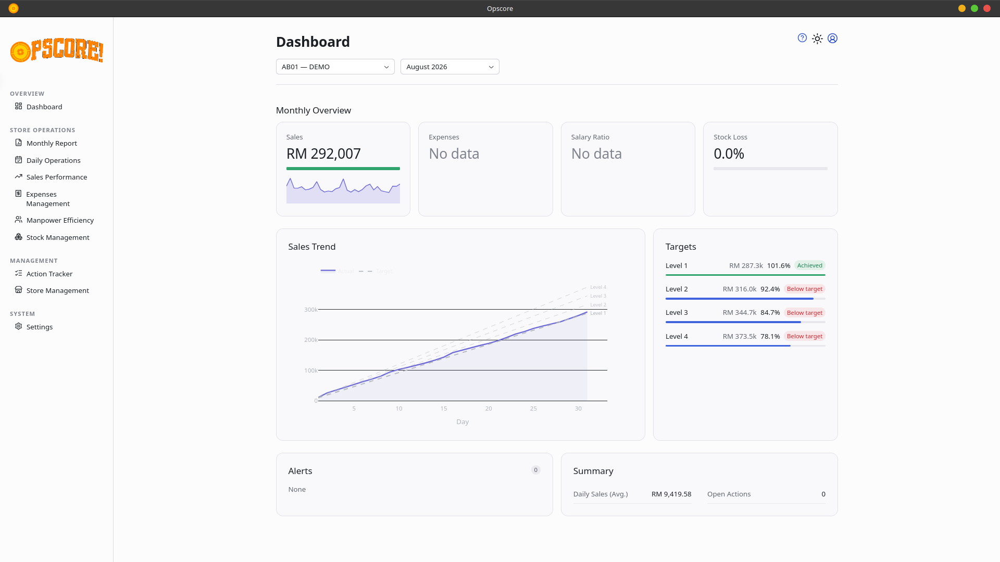
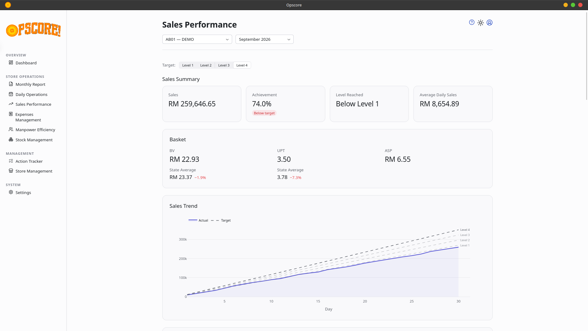
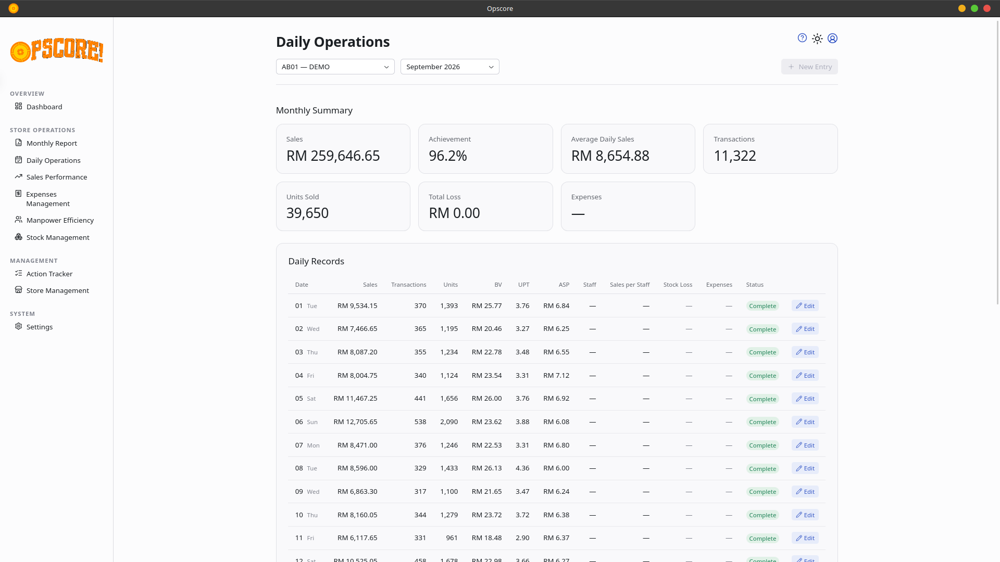
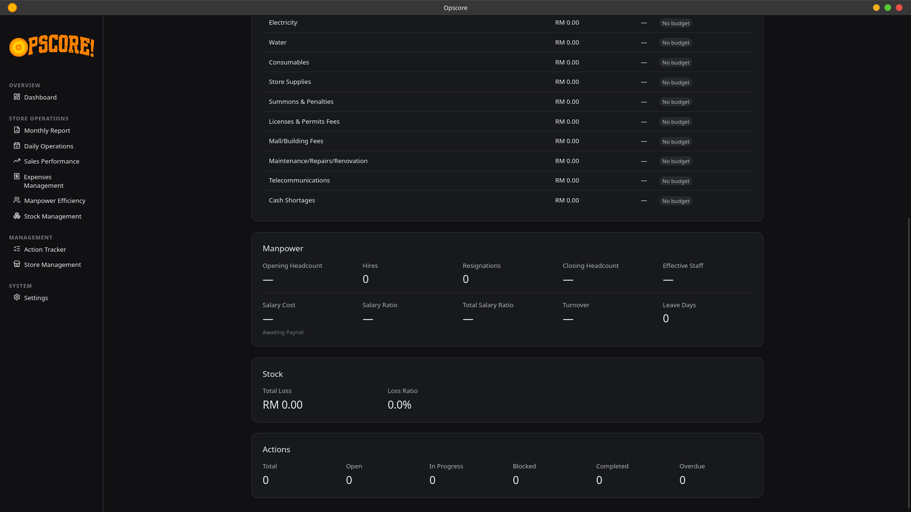

# Opscore

Opscore is an offline desktop app for retail store operations monitoring. It
replaces the Excel *Store Operations Monitoring* workbook with one local app
that tracks, per store and per month:

- Sales against four target levels, with daily targets and shortfall carry-forward
- Daily operations: sales, transactions, units, stock loss and staffing
- Expenses against category budgets
- Manpower efficiency, payroll, and weekly staff schedules
- Stock loss by code
- Corrective actions with follow-up
- Versioned, finalized monthly reports with Excel export

Each installation keeps its own database on its own machine. There is no
shared server and no cloud component; the app works fully offline after
installation.

The product name is **Opscore**. The Python package, repository and
environment-variable prefix remain `ducklab` / `DUCKLAB_` — internal naming
leftovers, not a separate product.

## Screenshots

*Sample data: demo store, fictional figures.*

### Dashboard

### Sales Performance

| Level 1 | Level 2 |
|---|---|
|  |  |

| Level 3 | Level 4 |
|---|---|
|  |  |

### Daily Operations and Monthly Report

| Daily Operations | Daily Entry |
|---|---|
|  |  |

| Monthly Report | Monthly Report (continued) |
|---|---|
|  |  |

## Supported platforms

| Platform | Package | Notes |
|---|---|---|
| Ubuntu / Debian (amd64) | `opscore_<version>_amd64.deb` | Self-contained: bundles Python 3.14 and the compiled frontend; no internet, Node or system Python needed at runtime. |
| Windows 10/11 (x64) | `Opscore-Setup-<version>.exe` | Per-user installer, no administrator rights required. Uses WebView2, with Microsoft Edge app mode and the default browser as fallbacks. |

Both packages install the same application and keep user data outside the
installation folder, so upgrading or uninstalling never deletes your data.

## Installation and quick start

1. **Download a release** from the project's GitHub Releases page: the `.deb`
   for Ubuntu/Debian or the `.exe` for Windows.
2. **Install it.**
   - Ubuntu/Debian: `sudo apt install ./opscore_<version>_amd64.deb`
   - Windows: run `Opscore-Setup-<version>.exe`.
3. **Open Opscore** from the app menu or Start Menu.
4. **Create Account** — the first account becomes the Super Admin. Save the
   recovery key it shows; it is single-use and displayed only once.
5. **Add a store** in **Store Management**, then complete **Monthly Setup**
   for the current month.
6. Start entering days in **Daily Operations**.

The full walkthrough, including upgrades and the keep/fresh database choice,
is in the [User Guide](USER_GUIDE.md).

## Where the data lives

| | Linux | Windows |
|---|---|---|
| Database | `~/.local/share/opscore/store_ops.db` | `%LOCALAPPDATA%\Opscore\store_ops.db` |
| Log | `~/.local/share/opscore/opscore.log` | `%LOCALAPPDATA%\Opscore\opscore.log` |
| Automatic migration/restore backups (newest 10) | `~/.local/share/opscore/backups/` | `%LOCALAPPDATA%\Opscore\backups\` |
| Schedule CSV exports | `~/Documents/Opscore Schedules/` | `%USERPROFILE%\Documents\Opscore Schedules\` |

Uninstalling the package preserves all of the above.

## Documentation

| Document | What it covers |
|---|---|
| [Project Overview](PROJECT_OVERVIEW.md) | Why Opscore exists, its scope, features and status |
| [User Guide](USER_GUIDE.md) | Installation, setup and step-by-step use of every page |
| [Architecture](ARCHITECTURE.md) | Technical design: layers, security, data flow, packaging, and developer setup |
| [Changelog](CHANGELOG.md) | Release history and what changed in each version |
| [Migrations](MIGRATIONS.md) | Database schema history, upgrades and recovery procedures |

**Developers:** to set up the project, run it from source and run the tests,
see the [Development section](ARCHITECTURE.md#12-development) in the
Architecture document.

## Troubleshooting entry point

- The app log is `opscore.log` in the data directory listed above.
- The packaged app serves only `http://127.0.0.1:47811`. If another
  application already uses that port, Opscore refuses to start and tells you
  to close the other application.
- If you forget your password, use your recovery key via **Forgot password?**
  on the sign-in page. If both are lost, an administrator can use the offline
  recovery script described in the [User Guide](USER_GUIDE.md#16-troubleshooting-and-faq).

## Project status

Current development release line: **v1.3** (see the [Changelog](CHANGELOG.md)).
Database schema version: **13**.

- Ubuntu/Debian desktop package: released and in use.
- Windows desktop package and installer: released from v1.1 onward; see the
  [Changelog](CHANGELOG.md) for the validation-status note on Windows builds.
- There is no macOS package and no hosted/server deployment.

## Privacy

Opscore is a local application. Operational data, accounts and password
hashes live only in the local SQLite database on each user's machine. Nothing
is sent to a server, and the packaged app binds to loopback (`127.0.0.1`)
only. Store concept names in the codebase and bundled reference data are
aliases; no real company data ships with the app.
