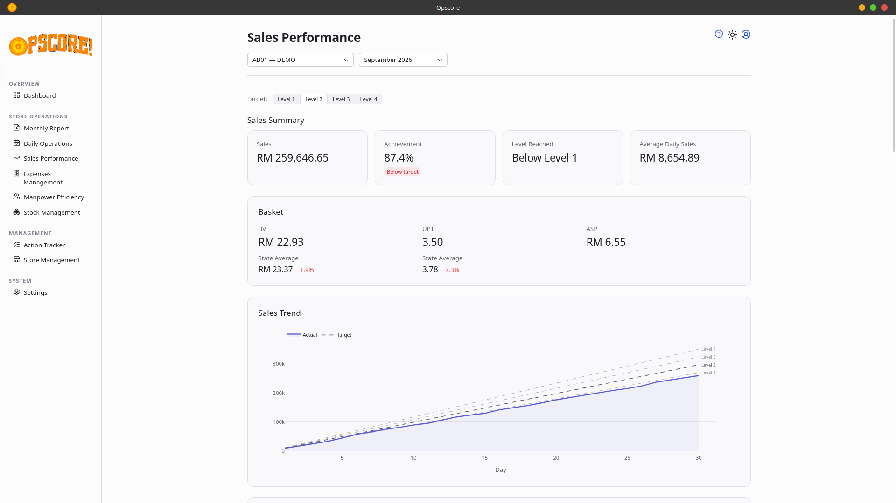
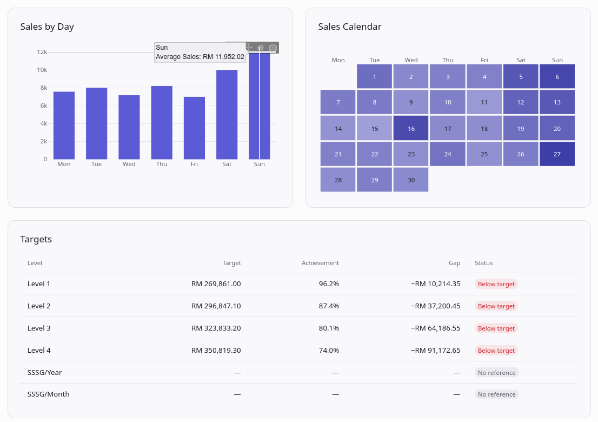
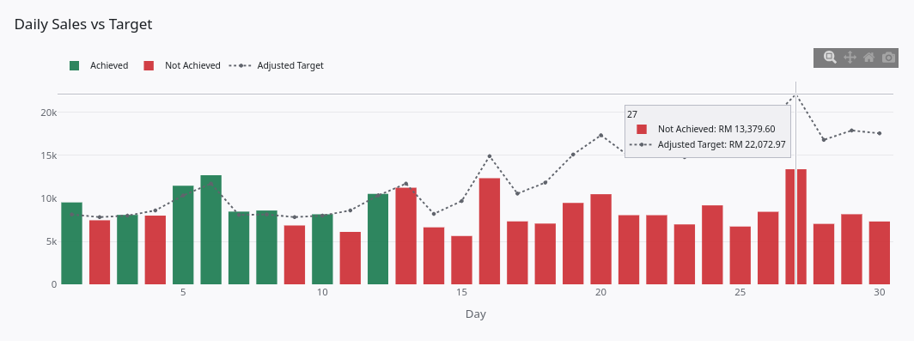
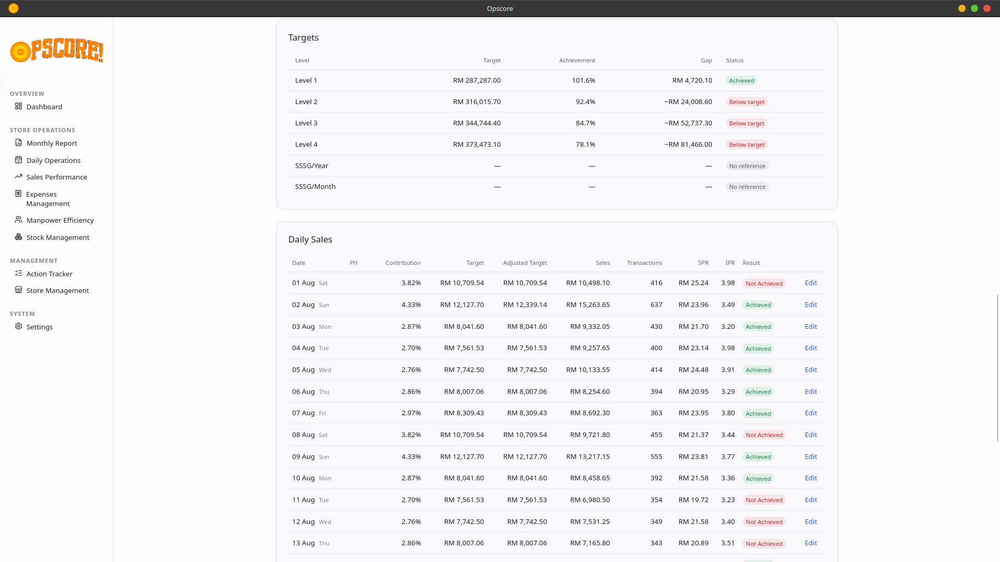
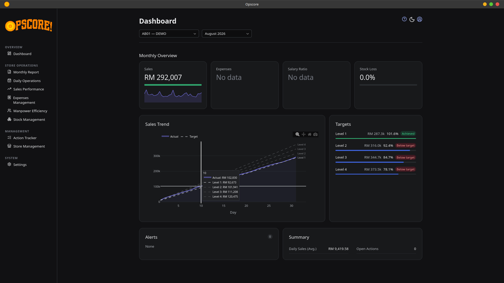
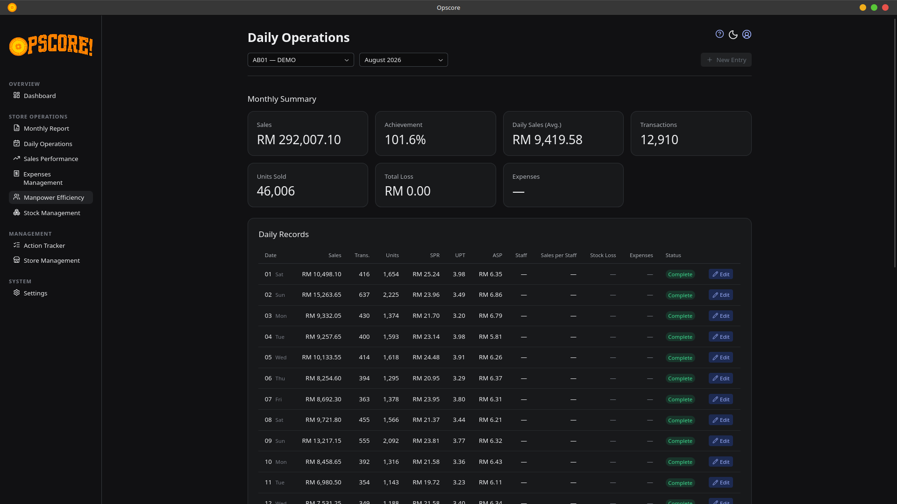
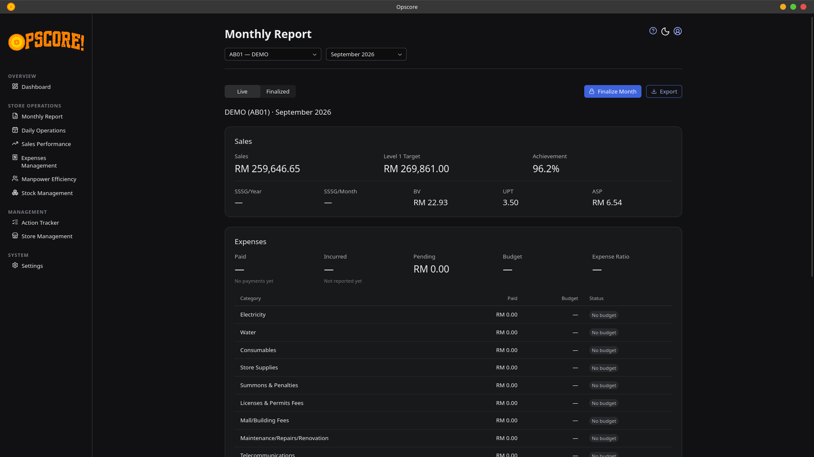
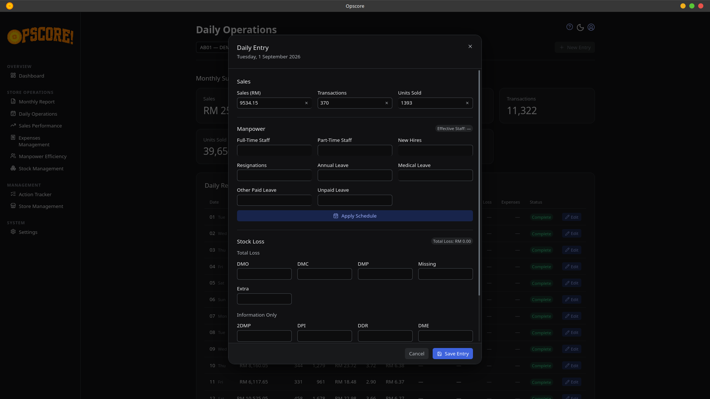

# Opscore (Prototype name: Ducklab)

Opscore is an offline desktop app for store operations monitoring. It replaces the Excel "Store Operations Monitoring" workbook with one app that tracks, per store and per month:

- Sales against four target levels, with daily targets and shortfall carry-forward
- Daily operations: sales, transactions, units, stock loss and staffing
- Expenses against budgets
- Manpower efficiency, salary ratio and weekly staff schedules
- Stock loss by code
- Corrective actions
- Versioned monthly reports, with Excel export

Each person installs their own copy, which keeps its own database on their own machine. There is no shared server.

The display name is **Opscore**. The code name, Python package and repository stay **ducklab**.

## Screenshots

*Sample data: AB01 - DEMO store, August 2026.*

### Dashboard


### Sales Performance and Daily Operations

| Sales Performance (Level 1) | Sales Performance (Level 2) |
|---|---|
|  |  |

| Sales Performance (Level 3) | Sales Performance (Level 4) |
|---|---|
|  |  |

| Daily Operations |
|---|
|  |

### Sales Charts



| Daily Sales vs Target |
|---|
|  |

### Daily Targets



### Dark Mode

| Dashboard | Daily Operations |
|---|---|
|  |  |

| Monthly Report | Monthly Report |
|---|---|
|  |  |

| Daily Entry |
|---|
|  |

## Documents

- [Project Overview](docs/PROJECT_OVERVIEW.md): why Opscore exists, the problem it solves, scope and timeline
- [Architecture](docs/ARCHITECTURE.md): layers, data model, KPI engine, security and packaging
- [User Guide](docs/USER_GUIDE.md): installing and using every page
- [Windows development](docs/windows-dev.md): running and building from source on Windows
- [Changelog](CHANGELOG.md): release history and current verification results

The overview, architecture, user guide and platform runbooks describe current behavior. Phase-specific documents and `docs/windows-build-plan.md` are historical records, not current procedures. Update the relevant current document when behavior changes; keep dated release entries as historical records.

---

## Status

| Area | Status |
|---|---|
| Core modules (Sales, Daily, Expenses, Manpower, Stock, Actions, Stores) | Done |
| KPI engine (`kpi.py`) | Done. Matched 102/102 metrics against the September 2026 workbook |
| Daily Sales Contribution (daily targets, carry-forward) | Done |
| Monthly Report and Excel export | Done |
| Settings (Account, Reference Data, Backup/Restore, About) | Done |
| First launch (Create Account) and page tours | Done |
| Ubuntu desktop app (`.deb`) | Done. Tested on Ubuntu with a native window |
| Weekly staff schedules, printing and CSV export | Done |
| Demo data import (AB01 / DEMO) | Done |
| Light mode default | Done |
| Windows packaging and installer | Implemented; published-release and real-machine validation status unverified |
| Wording pass (remove leftover subtitles and helper sentences) | Pending |
| Finalize and Correct on the Monthly Report page | Done |

**Latest local verification:** full test suite and production frontend build passed on 2026-11-09. See [Verification results](CHANGELOG.md#verification) for the recorded counts.
**Database schema:** version 10.

---

## Features

### Pages

| Page | Route | What it shows |
|---|---|---|
| Dashboard | `/ops` | Month at a glance across modules, with an All Stores view; accepts `/ops?store=<store-id>` deep links |
| Monthly Report | `/ops/report` | Live or finalized monthly report, All Stores live view, corrections and Excel export |
| Daily Operations | `/ops/daily` | Daily entry: sales, transactions, units, stock loss, staffing, and paid expenses by day |
| Sales Performance | `/ops/sales` | Level 1 to 4 achievement, Daily Target, Adjusted Target, SSSG/Year, SSSG/Month, BV, UPT |
| Expenses Management | `/ops/expenses` | Expense register and category budgets |
| Manpower Efficiency | `/ops/manpower` | Headcount, salary ratio, turnover and weekly staff schedules |
| Stock Management | `/ops/stock` | Stock loss by code against target |
| Action Tracker | `/ops/actions` | Corrective actions with priority and status |
| Store Management | `/ops/stores` | Stores, access and Monthly Setup (targets, budgets, holidays) |
| Settings | `/ops/settings` | Account, Reference Data, Backup/Restore, About (app and schema versions) |

### Business rules

- **Blank is not zero.** A blank day is "not reported". An entered 0 is a real zero. NULL is never turned into 0.
- **Money** is stored as integer cents. Percentages are stored as fractions (10% = 0.10).
- **Target levels:** Level 1 is the base target. Levels 2 to 4 are Level 1 plus their uplift. Level 4 is never below the minimum RTM target. All four levels must exist once Level 1 is set.
- **Projection:** month-end sales are actual when every day is entered, otherwise MTD ÷ days entered × days in month, labelled "Projected".
- **Daily targets** come from the Daily Sales Contribution file (by State, Concept and weekday or public holiday). A shortfall carries forward to the next *reported* day only.
- **Stock loss code DMQ** means Damage in Quality.
- **All KPI logic lives in `ducklab/kpi.py`** and `operations_service.py`. Pages only display results.

### Concepts and States

Concept names are aliases, so no company concept names appear in code or prompts:
Outlet, Mall, Retail, Mini Mall, Ringgit Mall, Toys, Express Toys.

States: Johor, Kedah, Kelantan, Melaka, N9, Pahang, Penang, Perak, Perlis, Sabah, Sarawak, Selangor, Terengganu, WP.

### Roles

| Role | Access |
|---|---|
| Super Admin | Everything, all stores, users, backup/restore |
| Administrator | Assigned stores: records, Monthly Setup, finalize reports |
| Zone Manager | Assigned stores: write daily, stock, expenses, actions; read reports |
| Branch Manager | Assigned stores: write daily, stock, expenses, actions; read reports |
| Viewer | Assigned stores: read only |

Access is deny-by-default and enforced server-side in `ducklab/authz.py`. Store access comes only from explicit assignments.

---

## Desktop app (Ubuntu / Debian)

### Build

```bash
cd ~/ducklab-dev && git checkout main && git pull
scripts/build_deb.sh 1.0
```

The package lands in `dist/` as `opscore_<version>_amd64.deb`. The version defaults to today's date. The build bundles Python 3.14, the prebuilt frontend and the Git-tracked reference workbook `ducklab/data/DSCSPR_alias_2027.xlsx`, so the installed app needs no internet, Node or system Python.

### Install and remove

```bash
sudo apt install ./dist/opscore_*_amd64.deb
sudo apt remove opscore
```

Opscore then appears in the app menu. It opens in its own window on `127.0.0.1:47811`. Closing the window stops the app. Clicking the icon again focuses the open window.

Before upgrading, download a backup in **Settings → Data**. Migrations run automatically on first launch and preserve existing records and accounts. Each migration and its schema-version update commit together in one transaction. Current schema version: 10 (see `deploy/MIGRATIONS.md` for the full history).

### Where the data lives

| File | Path |
|---|---|
| Database | `~/.local/share/opscore/store_ops.db` |
| Log | `~/.local/share/opscore/opscore.log` |
| Pre-restore backups | `~/.local/share/opscore/backups/` |

Removing the package never deletes user data. For a truly fresh start, move the folder aside first:

```bash
mv ~/.local/share/opscore ~/.local/share/opscore.old-$(date +%F)
```

## Windows installer and folder

Build on 64-bit Windows with internet access:

```powershell
.\scripts\build_windows.ps1 -Version 1.2
```

By default this is a **candidate build**: it writes `dist\Opscore-candidate` and leaves the published release artifacts (`dist\Opscore` and any `dist\Opscore-Setup-<version>.exe`) completely untouched. The build refuses to replace the published release folder, and it verifies afterwards that those artifacts were not modified or removed. Nothing is promoted automatically.

The script bundles standalone CPython 3.14, the locked dependencies, the production frontend and the reference workbook in the output folder. Copy the entire folder to any Windows 10/11 PC and double-click `Opscore.cmd`; Python, Git and Node are not required. The launcher uses `pythonw.exe` for a windowed start, and the package includes `assets\opscore.ico`. WebView2 is preferred, with Edge app mode and the default browser as fallbacks.

The build checks that both frontend entry points exist and that `.web\env.json` targets `127.0.0.1:47811`. The folder build itself does not create an installer or an archive.

Every run rebuilds the output folder from a clean staging tree, so stale application files can never survive into a new build. The downloaded CPython archive and the extracted runtime with its installed dependencies are kept in `dist\build-windows` and reused. After the frontend export, the build removes the files Reflex generates in the project root (`.gitignore`, `requirements.txt`) together with the `__pycache__` directories and `.pyc`/`.pyo` files left by the application import, and it then verifies that the package contains the Python runtime, the frontend entry points, the launcher, the backend and the reference workbook, and that `RELEASE` matches the requested version. A failed check aborts the build before the output folder is replaced.

### Build the Windows installer locally

Install [Inno Setup 6](https://jrsoftware.org/isinfo.php), open **Developer Command Prompt for Inno Setup**, and run from the repository root. For a candidate build, point the installer at the candidate folder:

```powershell
ISCC.exe /DOPSCORE_PACKAGE_NAME=Opscore-candidate /DOPSCORE_VERSION=1.2 packaging\windows\opscore.iss
```

This creates `dist\Opscore-Setup-1.2-candidate.exe`. A candidate package always produces a candidate installer, so the published installer is never replaced. The installer refuses to overwrite an existing file; remove it first, or pass `/DOPSCORE_ALLOW_OVERWRITE=1` deliberately.

The installer reads its version from the packaged `RELEASE` file, which `build_windows.ps1` writes using its `-Version` argument, `OPSCORE_VERSION`, or the current UTC date—the same version inputs as the `.deb` build. The installer therefore cannot describe a different version than the folder it packages. To require an exact version, pass `/DOPSCORE_VERSION=<version>`; a mismatch fails the compile.

### Release build

A release build writes `dist\Opscore` and must be requested explicitly:

```powershell
.\scripts\build_windows.ps1 -Version 1.2 -AllowReleaseOutput
ISCC.exe packaging\windows\opscore.iss
```

This creates `dist\Opscore-Setup-1.2.exe`. Use `-OutputName <folder>` to choose another folder name, and `-AllowOverwrite` to replace an existing output folder.

The installer is per-user and does not require administrator rights. It installs into `%LOCALAPPDATA%\Programs\Opscore`, adds an Opscore Start Menu shortcut, and offers an optional Desktop shortcut. Both shortcuts use `pythonw.exe`, so no console window flashes. Close Opscore when asked during installation or upgrade.

User data, including `store_ops.db` and `opscore.log`, is stored under `%LOCALAPPDATA%\Opscore`, separately from the program. Upgrades and uninstallation preserve this data folder. Moving or replacing the application folder also preserves user data.

## First launch

1. Opscore opens at **Create Account**. The first account is Super Admin.
2. The welcome tour starts, and each page runs its own tour on first visit.
3. Reference data is loaded automatically from the bundled workbook when both reference tables are empty. In **Settings → Reference Data**, Super Admin and Administrator users can upload a replacement Daily Sales Contribution file (up to 64 MiB).
4. In **Store Management**, add a store and set Monthly Setup.

---

## Demo data (AB01 / DEMO)

Four months (June to September 2026) of demo sales for presentations. Keep the CSVs **outside the repo**, for example in `~/Documents/ducklab-private/`.

1. Install, open Opscore, create the account and upload the Daily Sales Contribution file. Then close the app.
2. Import:
   ```bash
   cd ~/ducklab-dev && .venv/bin/python scripts/import_demo.py \
     --db ~/.local/share/opscore/store_ops.db \
     ~/Documents/ducklab-private/demo_ab01.csv \
     ~/Documents/ducklab-private/demo_ab01_setup.csv
   ```
3. Open Opscore and check Sales Performance:

   | Month | Sales |
   |---|---|
   | June | RM 273,212.50 (23 and 24 Jun not reported) |
   | July | RM 281,246.25 |
   | August | RM 292,007.10 |
   | September | RM 259,646.65 |

4. **Settings → Data → Download Backup** and keep the file. After any reinstall, create the account and use **Restore Database**. Restore keeps a pre-restore backup, validates and migrates a temporary copy (including integrity and foreign-key checks), then atomically replaces the live database.

CSV headers:

- `demo_ab01.csv`: `store_code,date,sales,transactions,items_sold`
- `demo_ab01_setup.csv`: `store_code,store_name,concept,state,month,base_target,level2_uplift_pct,level3_uplift_pct,level4_uplift_pct,level4_min,holidays`

Uplifts are whole percents. Holidays are ISO dates separated by `;`. The script is safe to run twice.

---

## Development

### Folders on the Ubuntu desktop

| Folder | Purpose |
|---|---|
| `~/ducklab` | Live copy, run by a systemd user service on port 3000. **No agents here.** |
| `~/ducklab-dev` | Agent working copy (OpenCode). Branches and PRs only. |
| `~/.local/share/ducklab/store_ops.db` | Live copy's database |
| `~/.local/share/opscore/store_ops.db` | Installed desktop app's database |
| `~/Documents/ducklab-private/` | Private data (workbook tests, demo CSVs). Never committed. |

### Setup

```bash
pip install uv
uv venv --python 3.14 .venv
uv pip install --python .venv/bin/python -r requirements.lock -r requirements-dev.txt
```

### Run

```bash
DUCKLAB_DB_PATH=$(mktemp -d)/dev.db .venv/bin/reflex run
```

Frontend on `http://localhost:3000`, backend on `http://localhost:8000`.

### Test

```bash
.venv/bin/python -m pytest tests/ -q
DUCKLAB_DB_PATH=$(mktemp -d)/compile.db .venv/bin/reflex export --env prod --frontend-only --no-zip
```

Both must pass before a PR is opened.

### Update the live copy after a merge

```bash
cp ~/.local/share/ducklab/store_ops.db ~/.local/share/ducklab/store_ops.db.bak-$(date +%F)
cd ~/ducklab && git pull && systemctl --user restart ducklab
```

### Agent rules

- Work in `~/ducklab-dev` only. Never touch `~/ducklab` or `~/.local/share/ducklab`.
- One branch per task, push, open a PR. Never push to main, never merge.
- Tests and screenshots use disposable databases only.
- Keep prompts short: a few numbered lines, plain wording.

### UI wording

Title Case, short one or two word labels (Salary Ratio, Stock Loss, Daily Target, Required Daily Sales). No "MTD", dashes, "% of", formulas or explanatory subtitles.

---

## Scripts

| Script | Purpose |
|---|---|
| `scripts/build_deb.sh` | Build the Ubuntu desktop package |
| `scripts/build_windows.ps1` | Build the self-contained Windows folder |
| `scripts/import_demo.py` | Import the AB01 demo CSVs into a given database |
| `scripts/import_dsc.py` | Import the Daily Sales Contribution file (needs `DUCKLAB_DB_PATH`) |
| `scripts/import_workbook_dev.py` | Import a workbook into the dev database, with `--verify` parity check |
| `scripts/bootstrap_admin.py` | Create the first admin from the terminal |
| `scripts/recover_admin_password.py` | Offline admin password recovery (backs up the DB, revokes sessions) |
| `scripts/seed_ui_*.py` | Seed disposable dev databases for screenshots and browser tests |
| `scripts/browser_test_*.py` | Playwright browser checks |
| `scripts/dev-live.sh` | Start and stop the dev instance on the VPS |

---

## Project structure

```
ducklab/
  ducklab.py                  App and routes
  kpi.py                      All business calculations (pure functions)
  operations_service.py       Monthly report assembly
  operations_repository.py    Reads
  operations_write_*.py       Validated writes
  operations_snapshots.py     Finalized, versioned monthly reports
  app_service.py              Authenticated service boundary
  auth_*.py, authz.py         Accounts, sessions, roles
  dsc_import.py               Daily Sales Contribution import
  reference_bootstrap.py      Bundled reference data and expense-category seeds
  data/DSCSPR_alias_2027.xlsx Git-tracked default reference workbook
  backup.py                   Backup and restore
  report_export.py            Excel export
  ops_*_pages.py / _state.py  Pages and their state
  ops_charts.py, design.py    Charts and shared design kit
  store_ops_db.py             SQLite schema and migrations
packaging/                    Desktop launcher, .desktop entry, nFPM config
scripts/                      Build, import, seed and browser-test tools
deploy/                       VPS release pipeline (see deploy/RELEASES.md)
tests/                        Backend test suite
assets/                       Logo, icons, favicon
```

---

## History

| PRs | Milestone |
|---|---|
| #1–#6 | Toolchain, design kit, Stock, Manpower, Expenses, Actions pages, polish |
| #7–#9 | Level 1 to 4 targets and Sales Performance fixes |
| #10–#14 | Dashboard, Monthly Report, Daily Operations, page polish, actions and expenses fixes |
| #15–#17 | Daily entry rework, Daily Sales Contribution targets, import fix |
| #18–#22 | Plotly charts, polish, private data scrub, hover fixes, Opscore branding |
| #23–#26 | Settings: Account, Reference Data, Backup/Restore |
| #27–#29 | First launch and page tours |
| #30 | Monthly report Excel export |
| #31 | Ubuntu desktop app (`.deb`) |
| #32 | Demo data import, light mode default |
| #33–#35 | Project documentation and desktop release preparation |
| #36 | Application screenshots |
| #37–#38 | Weekly schedule planner, print view and CSV export |

---

## Next

1. Wording pass on Store Management and other pages (remove subtitles and helper sentences, Title Case labels).
2. Validate the implemented Windows packaging and installer on real machines, then prepare signed, checksummed release artifacts.

## Data privacy

Real company data never goes into the repo. Workbook-derived tests live in the git-ignored `tests/private/`. Demo CSVs and private reference files stay in `~/Documents/ducklab-private/`; the aliased default workbook `ducklab/data/DSCSPR_alias_2027.xlsx` is intentionally tracked in Git and bundled with desktop builds. Concept names in code are aliases only.
